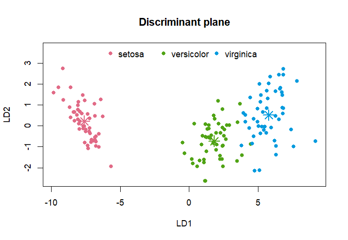
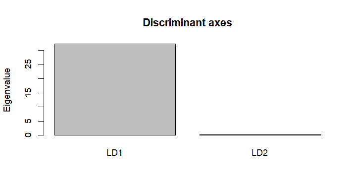
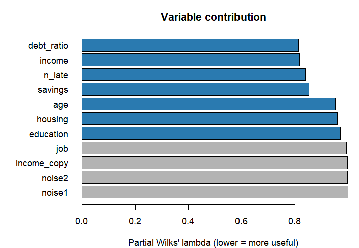

`ldaR6` implements predictive **linear discriminant analysis (LDA)** as an `R6` class with a
scikit-learn like interface (`$fit()`, `$predict()`, `$predict_proba()`), tests of significance
(Wilks' lambda, Rao's F), stepwise variable selection, categorical predictors, and a **Shiny** application.
This tutorial is fully reproducible: every output below was produced by knitting this file.

## 1. Installation

```r
# from GitHub (replace clark94 by the account hosting the repository)
install.packages("remotes")
remotes::install_github("clark94/ldaR6")

# fallback: local archive shipped with the repository (RStudio: Tools > Install Packages > Package Archive File)
install.packages("ldaR6_1.0.0.tar.gz", repos = NULL, type = "source")
```


``` r
library(ldaR6)
```

## 2. Fit a model: `$fit()`

The constructor only stores parameters; `$fit(X, y)` learns the model. `X` is a data frame of
explanatory variables and `y` a factor.


``` r
model <- LDA$new()                      # default: proportional priors, no selection
model$fit(iris[, 1:4], iris$Species)
model                                   # concise print
#> Linear Discriminant Analysis (R6 class 'LDA')
#>   Observations: 150 | classes: 3 (setosa, versicolor, virginica)
#>   Variables kept: 4 column(s) from 4 variable(s) [selection: none, encoding: dummy]
#>   Priors: setosa=0.333, versicolor=0.333, virginica=0.333
#>   Wilks' lambda = 0.02344, Rao F(8, 288) = 199.1, p < 2.2e-16
#>   Resubstitution accuracy: 98.00%
#>   Use $summary() for details, $coefficients for the classification functions.
```

### Outputs of `$fit()`

| Field | Content |
|---|---|
| `$coefficients` | classification functions (first row = constant), same as SAS `PROC DISCRIM` |
| `$wilks` | global Wilks' lambda test (Rao's F), Pillai / Hotelling-Lawley / Roy statistics, Bartlett chi-square |
| `$variables` | per-variable table: univariate and **partial** Wilks' lambda, F, p-value, status |
| `$canonical` | discriminant axes: coefficients, eigenvalues, canonical correlations, structure, class centroids |
| `$distances` | squared Mahalanobis distances between classes and their F-test p-values |
| `$selected`, `$selection_history` | retained variables and the stepwise path |
| `$confusion_train`, `$accuracy_train` | resubstitution results |
| `$pooled_cov`, `$means`, `$priors`, `$classes` | model ingredients |


``` r
round(model$coefficients, 4)
#>                setosa versicolor virginica
#> constant     -86.3085   -72.8526 -104.3683
#> Sepal.Length  23.5442    15.6982   12.4458
#> Sepal.Width   23.5879     7.0725    3.6853
#> Petal.Length -16.4306     5.2115   12.7665
#> Petal.Width  -17.3984     6.4342   21.0791
model$wilks$global
#>       statistic      value        F df1 df2       p_value
#> 1 Wilks' lambda 0.02343863 199.1453   8 288 1.365006e-112
model$variables[, c("variable", "univ_lambda", "partial_lambda", "partial_F", "partial_p", "status")]
#>       variable univ_lambda partial_lambda partial_F    partial_p       status
#> 1 Sepal.Length  0.38129427      0.9384635  4.721152 1.032884e-02 contributing
#> 2  Sepal.Width  0.59921715      0.7664799 21.935928 4.831201e-09 contributing
#> 3 Petal.Length  0.05862828      0.6692061 35.590175 2.756205e-13 contributing
#> 4  Petal.Width  0.07111707      0.7430008 24.904333 5.143154e-10 contributing
model$confusion_train
#>             Predicted
#> Observed     setosa versicolor virginica
#>   setosa         50          0         0
#>   versicolor      0         48         2
#>   virginica       0          1        49
```

`model$summary()` prints the complete report (see the "Print / summary" tab in the Shiny app).

## 3. Predict: `$predict()`, `$predict_proba()`


``` r
new <- iris[c(1, 60, 120), 1:4]
model$predict(new)                       # classes
#> [1] setosa     versicolor virginica 
#> Levels: setosa versicolor virginica
round(model$predict_proba(new), 4)       # posterior probabilities
#>      setosa versicolor virginica
#> [1,]      1     0.0000    0.0000
#> [2,]      0     0.9995    0.0005
#> [3,]      0     0.2208    0.7792
round(model$transform(new), 3)           # coordinates on the discriminant axes
#>         LD1    LD2
#> [1,] -8.062  0.300
#> [2,]  1.958 -0.352
#> [3,]  4.765 -2.156
model$score(iris[, 1:4], iris$Species)   # accuracy
#> [1] 0.98
```

The usual generics work too: `predict(model, new, type = "prob")`, `coef(model)`, `summary(model)`, `plot(model)`.

## 4. Graphics


``` r
model$plot("scores")
```




``` r
model$plot("axes")
```



## 5. Categorical predictors

`credit_demo` mixes numeric and categorical variables (and includes noise and a redundant variable).


``` r
data(credit_demo)
str(credit_demo)
#> 'data.frame':	900 obs. of  12 variables:
#>  $ risk       : Factor w/ 3 levels "low","medium",..: 2 2 1 1 2 1 2 3 1 2 ...
#>  $ age        : num  46 52 49 47 57 54 47 46 50 75 ...
#>  $ income     : num  2980 3003 3331 4988 1582 ...
#>  $ debt_ratio : num  0.378 0.461 0.25 0.12 0.16 0.232 0.249 0.516 0.238 0.2 ...
#>  $ savings    : num  2459 6345 10311 9550 8808 ...
#>  $ n_late     : int  1 0 0 1 0 0 0 4 0 0 ...
#>  $ income_copy: num  2942 2993 3370 5083 1600 ...
#>  $ noise1     : num  -1.085 -0.946 0.302 -0.177 -1.367 ...
#>  $ noise2     : num  8.3 6.12 10.42 5.91 10.85 ...
#>  $ housing    : Factor w/ 3 levels "own","rent","free": 2 2 1 2 2 1 2 3 1 2 ...
#>  $ job        : Factor w/ 4 levels "employee","manager",..: 3 3 2 3 3 1 2 1 1 1 ...
#>  $ education  : Ord.factor w/ 3 levels "primary"<"secondary"<..: 2 3 2 2 3 2 1 2 3 3 ...
X <- credit_demo[, -1]; y <- credit_demo$risk
```

Categorical variables are recoded **before** the matrix computation (`encoding`):

* `"dummy"` (default): *k-1* indicator columns, keeps the covariance matrix invertible;
* `"onehot"`: *k* columns, the pooled covariance becomes singular (the package falls back on a
  pseudo-inverse and warns; predictions are identical to `"dummy"`);
* `"label"`: integer codes, only sensible for *ordered* factors.


``` r
m_dummy <- LDA$new(encoding = "dummy")$fit(X, y)
m_onehot <- suppressWarnings(LDA$new(encoding = "onehot")$fit(X, y))
c(dummy = m_dummy$accuracy_train, onehot = m_onehot$accuracy_train)
#>     dummy    onehot 
#> 0.8222222 0.8222222
rownames(m_dummy$coefficients)
#>  [1] "constant"            "age"                 "income"             
#>  [4] "debt_ratio"          "savings"             "n_late"             
#>  [7] "income_copy"         "noise1"              "noise2"             
#> [10] "housing=rent"        "housing=free"        "job=manager"        
#> [13] "job=self-employed"   "job=worker"          "education=secondary"
#> [16] "education=higher"
```

## 6. Variable selection and contribution

`selection` can be `"forward"`, `"backward"` or `"both"` (stepwise); the criterion is the partial Wilks' lambda
with the F-test thresholds `alpha_enter` / `alpha_stay` (as SAS `PROC STEPDISC`). A categorical variable
enters or leaves as a whole.


``` r
m <- LDA$new(selection = "both")$fit(X, y)
m$selected
#> [1] "debt_ratio" "income"     "n_late"     "savings"    "age"       
#> [6] "housing"    "education"
m$selection_history[, c("step", "action", "variable", "partial_lambda", "p_value", "wilks")]
#>   step action   variable partial_lambda       p_value     wilks
#> 1    1  enter debt_ratio      0.5611498 2.896348e-113 0.5611498
#> 2    2  enter     income      0.7055352  1.368891e-68 0.3959109
#> 3    3  enter     n_late      0.7858750  1.481398e-47 0.3111365
#> 4    4  enter    savings      0.8396892  1.205057e-34 0.2612580
#> 5    5  enter        age      0.9520383  2.945767e-10 0.2487276
#> 6    6  enter    housing      0.9614304  4.503700e-07 0.2391343
#> 7    7  enter  education      0.9708306  2.712118e-05 0.2321589
m$variables[, c("variable", "type", "univ_p", "partial_p", "status")]
#>       variable    type        univ_p    partial_p        status
#> 1          age numeric  3.720407e-30 7.116374e-10  contributing
#> 2       income numeric 1.354502e-107 8.231075e-40  contributing
#> 3   debt_ratio numeric 2.896348e-113 1.541478e-40  contributing
#> 4      savings numeric 1.834792e-102 1.397600e-31  contributing
#> 5       n_late numeric  2.253336e-99 1.170150e-34  contributing
#> 6  income_copy numeric 9.217751e-108 3.465365e-01     redundant
#> 7       noise1 numeric  7.116295e-01 9.222475e-01 uninformative
#> 8       noise2 numeric  7.599991e-01 5.524387e-01 uninformative
#> 9      housing  factor  1.813349e-20 2.895846e-07  contributing
#> 10         job  factor  6.658060e-02 4.775416e-01 uninformative
#> 11   education  factor  1.240577e-11 2.712118e-05  contributing
```

Status meaning:

* **contributing**: brings information given the other variables;
* **redundant**: informative alone (`univ_p` small) but adds nothing once the others are in (e.g. `income_copy`);
* **uninformative**: no link with the target (`noise1`, `noise2`, `job`).


``` r
m$plot("importance")
```



A fourth category, **perturbing** variables, is detected by cross-validation: a variable is perturbing
when removing it *increases* the cross-validated accuracy.


``` r
m$variable_audit(X, y, k = 5, seed = 1)
#>     variable cv_accuracy_without       delta verdict
#> 1 debt_ratio           0.7677778 0.048888889  useful
#> 2     income           0.7700000 0.046666667  useful
#> 3     n_late           0.7833333 0.033333333  useful
#> 4    savings           0.7922222 0.024444444  useful
#> 5        age           0.8122222 0.004444444  useful
#> 6    housing           0.8155556 0.001111111  useful
#> 7  education           0.8100000 0.006666667  useful
```

## 7. Honest evaluation: cross-validation

The whole pipeline (encoding, selection, fit) is repeated inside each fold, so the estimate is not biased by the selection.


``` r
m$cross_validate(X, y, k = 10, seed = 1)
#> 10-fold cross-validation: accuracy = 81.56% (error = 18.44%)
#>         Predicted
#> Observed low medium high
#>   low    318     43    0
#>   medium  50    258   26
#>   high     0     47  158
```

## 8. High dimension and long data


``` r
wide <- simulate_lda_data(n = 100, p = 400, K = 3, seed = 1)   # p > n: W is singular
m_pinv <- tryCatch(LDA$new()$fit(wide[, -1], wide$y), warning = function(w) conditionMessage(w))
m_pinv
#> [1] "Pooled covariance matrix is singular (rank 97 < 400): a pseudo-inverse is used. Consider `shrinkage` > 0, a variable selection or `encoding = 'dummy'`."
m_shr <- LDA$new(shrinkage = 0.3)$fit(wide[, -1], wide$y)       # shrinkage towards the diagonal
m_fwd <- LDA$new(selection = "forward", alpha_enter = 0.01)$fit(wide[, -1], wide$y)
c(shrinkage_cv = m_shr$cross_validate(wide[, -1], wide$y, k = 5, seed = 1)$accuracy,
  forward_cv   = m_fwd$cross_validate(wide[, -1], wide$y, k = 5, seed = 1)$accuracy)
#> shrinkage_cv   forward_cv 
#>         0.60         0.77
```

For very long data the within-class SSCP matrix is accumulated by chunks (`chunk_size`) so memory stays bounded;
see `benchmarks/benchmark.R` for timings against `MASS::lda`.

## 9. Priors, illustrative variables


``` r
LDA$new(priors = "equal")$fit(X, y)$priors
#>       low    medium      high 
#> 0.3333333 0.3333333 0.3333333
LDA$new(priors = c(low = 0.2, medium = 0.3, high = 0.5))$fit(X, y)$priors
#>    low medium   high 
#>    0.2    0.3    0.5
```

Illustrative variables are not used by the model; they are described on the discriminant axes
(correlations for numeric ones, barycentres for categorical ones).


``` r
m_small <- LDA$new()$fit(X[, c("income", "debt_ratio", "savings")], y)
m_small$project_illustrative(credit_demo[, c("age", "job")])
#> $numeric
#>            LD1        LD2
#> age -0.2976469 0.01697717
#> 
#> $categorical
#>   variable         level   n          LD1         LD2
#> 1      job      employee 235 -0.201579745 -0.05085095
#> 2      job       manager 212  0.282427631 -0.02346190
#> 3      job self-employed 225 -0.004362677  0.02755562
#> 4      job        worker 228 -0.050534278  0.04703456
```

## 10. Scoring a file (what the Shiny app does)


``` r
f_train <- system.file("extdata", "credit_demo.tsv", package = "ldaR6")
f_new   <- system.file("extdata", "credit_new.tsv",  package = "ldaR6")
train <- read_data(f_train)                       # tab separated by default
fit   <- LDA$new(selection = "both")$fit(train[, -1], factor(train$risk))
newd  <- read_data(f_new)                         # descriptors only
out   <- cbind(newd, predicted = as.character(fit$predict(newd)))
head(out[, c("age", "income", "predicted")])
#>   age income predicted
#> 1  44   1418      high
#> 2  45   2920    medium
#> 3  53   3089    medium
#> 4  53   2979      high
#> 5  32   3204    medium
#> 6  35   1758    medium
write.table(out, tempfile(fileext = ".tsv"), sep = "\t", row.names = FALSE, quote = FALSE)
```

## 11. The Shiny application

```r
ldaR6::run_app()
```

1. **Data**: load a CSV/TSV/Excel file (tab separator by default) or use a built-in example.
2. **Model setup**: choose the target, the explanatory and the illustrative variables, then the
   parameters (priors, encoding, selection, shrinkage, train/test split, cross-validation) and press *Run*.
3. **Results**: overview, classification functions (downloadable), tests, variable contributions,
   confusion matrices (train / test / CV), discriminant plane, illustrative variables, full summary.
4. **Predict**: one individual (a form generated from the variables of the model) or a whole file,
   with a downloadable TSV of predicted classes and probabilities.

## 12. Checking the computations against SAS PROC DISCRIM

The classification functions follow the SAS definition (pooled covariance matrix, `ln(prior)` in the constant).
To compare on your own data, run in SAS:

```sas
proc discrim data=mydata method=normal pool=yes crossvalidate;
  class target;
  var x1 x2 x3;
  priors proportional;   /* or: priors equal; */
run;
```

and compare "Linear Discriminant Function for target" with `model$coefficients`, the squared distances
with `model$distances$d2`, and `Wilks' Lambda` / `Approx F` with `model$wilks$global`. On the iris data the slopes of the
classification functions are 23.54417, 15.69821 and 12.44585 for the sepal length, which are the values usually reproduced
for this example in the SAS documentation (we had no SAS licence to re-run it ourselves: please confirm on your own SAS).
Posterior probabilities agree with `MASS::lda` to 1e-14 (see `tests/testthat/test-lda-core.R`).
Wilks' lambda, Rao's F and Pillai's trace are also checked against `stats::manova`.


``` r
# worked example: slopes for the sepal length, and agreement with MASS::lda
round(LDA$new()$fit(iris[, 1:4], iris$Species)$coefficients["Sepal.Length", ], 5)
#>     setosa versicolor  virginica 
#>   23.54417   15.69821   12.44585
l <- MASS::lda(iris[, 1:4], iris$Species)
max(abs(predict(l, iris[, 1:4])$posterior - model$predict_proba(iris[, 1:4])))
#> [1] 5.218048e-15
```

## Session information


``` r
sessionInfo()$R.version$version.string
#> [1] "R version 4.5.2 (2025-10-31 ucrt)"
packageVersion("ldaR6")
#> [1] '1.0.0'
```
